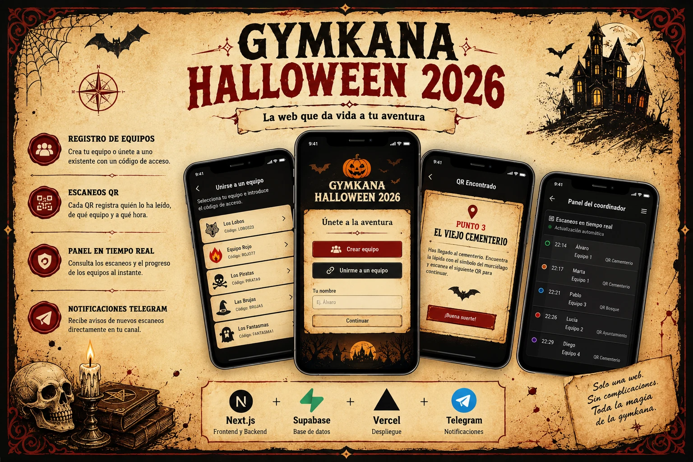
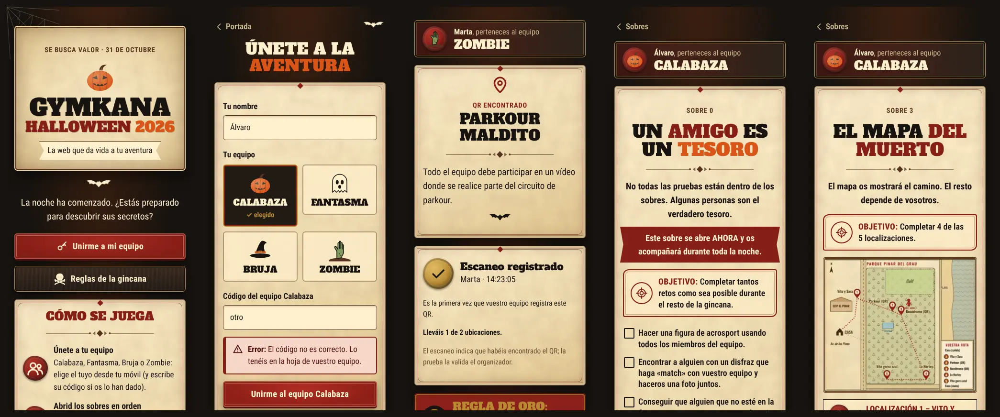
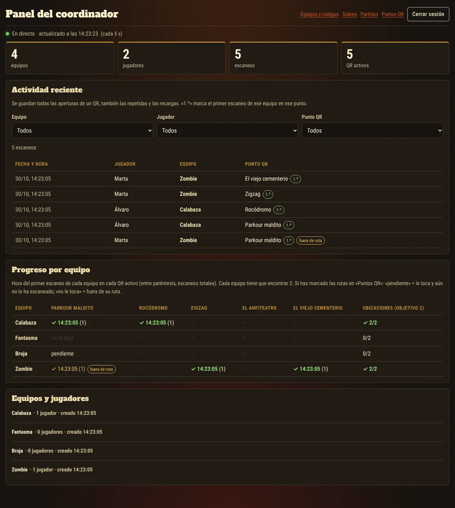
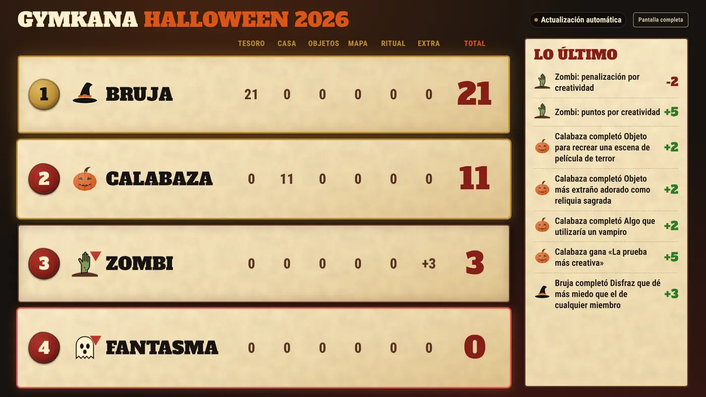
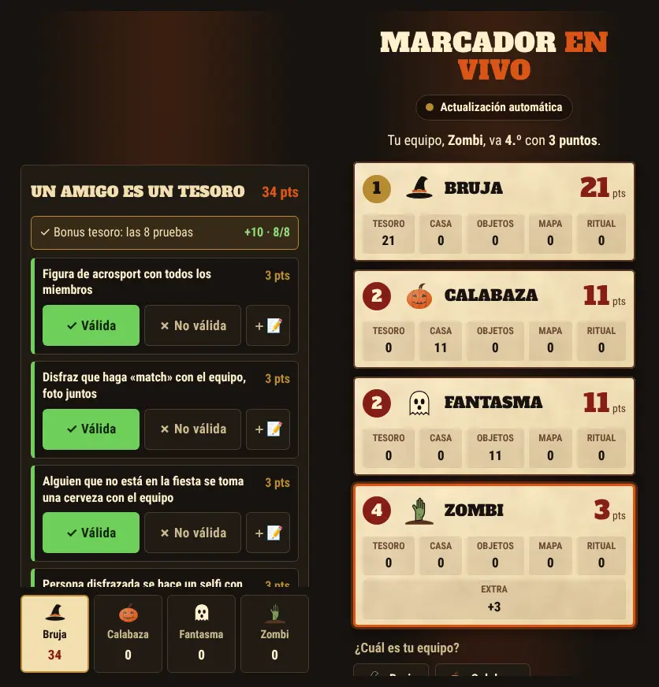
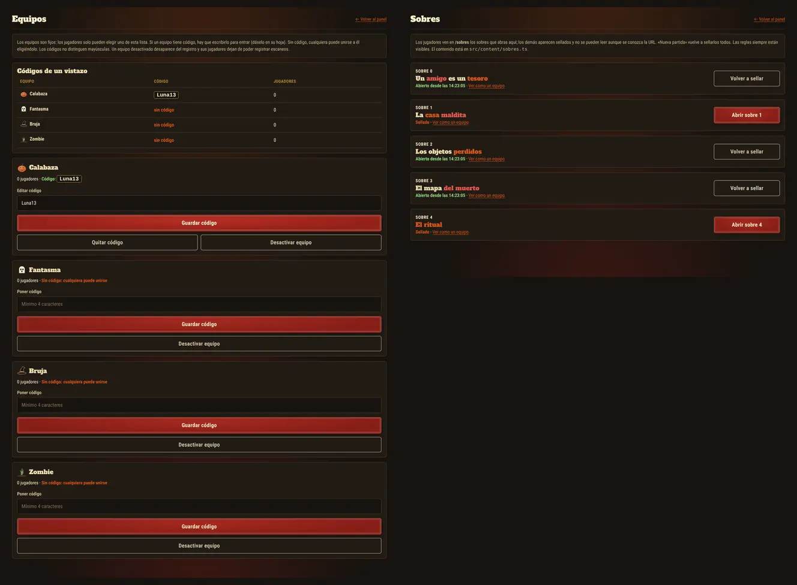
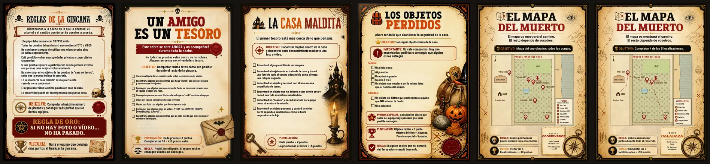
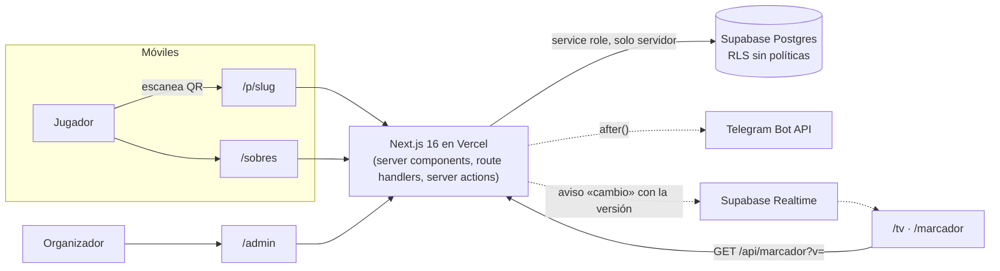

<div align="center">

# 🎃 Gymkana Halloween 2026

**La web que da vida a tu aventura.**

Una web móvil que acompaña a una gincana de Halloween que se juega en papel: equipos, sobres que se abren por turnos, QR escondidos en un parque y un panel en directo para el organizador.




</div>

---

## Índice

1. [El proyecto en 30 segundos](#1-el-proyecto-en-30-segundos)
2. [Capturas](#2-capturas)
3. [Cómo se juega](#3-cómo-se-juega)
4. [Funcionalidades](#4-funcionalidades)
5. [Diseño: de la hoja impresa a la pantalla](#5-diseño-de-la-hoja-impresa-a-la-pantalla)
6. [Arquitectura y decisiones técnicas](#6-arquitectura-y-decisiones-técnicas)
7. [Puesta en marcha](#7-puesta-en-marcha)
8. [Checklist del día del evento](#8-checklist-del-día-del-evento)
9. [Reutilizarlo otro año](#9-reutilizarlo-otro-año)
10. [Pruebas](#10-pruebas)
11. [Seguridad y limitaciones](#11-seguridad-y-limitaciones)

---

## 1. El proyecto en 30 segundos

**El problema.** Una gincana de Halloween para amigos, totalmente analógica: hojas impresas, sobres, retos con foto o vídeo enviados por WhatsApp. El organizador necesitaba saber **quién estaba en qué equipo** y **cuándo encontraba cada equipo los QR** escondidos por el parque, sin perseguir a nadie por el chat.

**La solución.** Una web sin instalación:
- Los jugadores **escanean un QR, eligen equipo** y desde ese momento el móvil sabe quiénes son.
- **Los sobres** aparecen en la web cuando el organizador los abre, personalizados para cada equipo: su ruta, su mapa, su nombre dentro de los retos.
- **Cada QR del parque** muestra la prueba y avisa al organizador al instante (panel en directo y Telegram), indicando si el equipo iba por su ruta o se ha desviado.
- **Marcador en tiempo real**: el organizador valida las pruebas desde el móvil y la tele de casa (`/tv`) y los móviles (`/marcador`) ven la clasificación moverse al instante.
- **Ensayos ilimitados**: guardar la partida, empezar de cero y restaurar si algo sale mal.

**Lo que no hace, a propósito.** No sube fotos ni vídeos: las evidencias llegan por WhatsApp y el organizador valida cada prueba a mano en su panel. *Si no hay foto o vídeo… no ha pasado*.

## 2. Capturas

**Móvil del jugador:** portada, unirse a un equipo, QR encontrado, sobre 0 y sobre 3 con el mapa de su ruta.



**Panel del organizador:** actividad en directo con filtros y matriz de progreso con rutas («pendiente», «no le toca», «fuera de ruta»).



**Marcador en la tele** (`/tv`): clasificación con animación al cambiar de puesto y lo último que ha pasado.



**Puntuar desde el móvil** (`/admin/puntos`) y **marcador en el móvil** de los jugadores (`/marcador`).



**Gestión:** códigos de equipo de un vistazo y apertura de sobres.



**Las hojas impresas** que inspiran el diseño: reglas, sobres 0 a 2, mapa del coordinador y mapa de un equipo.



> Las capturas se generaron con datos de prueba durante los tests automáticos (ver §10).

## 3. Cómo se juega

- **4 equipos fijos:** Calabaza 🎃, Fantasma 👻, Bruja 🧙 y Zombie 🧟 («Zombi» en las hojas impresas).
- **Salida y meta:** la Casa.
- **Escenario:** el Parque Pinar del Grau.

| Sobre | Qué es | En la web |
|---|---|---|
| Reglas de la gincana | 9 reglas, objetivo, regla de oro, victoria | Siempre visible en `/reglas` |
| 0 · Un amigo es un tesoro | Retos con gente durante toda la noche («FELIZ HALLOWEEN, EQUIPO …» con su nombre) | Cuando el organizador lo abre |
| 1 · La casa maldita | Objetos dentro de la casa | Cuando se abre |
| 2 · Los objetos perdidos | Objetos fuera de la casa (incluye «un objeto que empiece por la letra de vuestro equipo», con su letra) | Cuando se abre |
| 3 · El mapa del muerto | Ruta de 5 localizaciones por equipo, 2 de ellas con QR | Cuando se abre, con el mapa y la ruta **de su equipo** y los QR ya escaneados marcados |
| 4 · El ritual | El último sobre y la prueba final | Cuando se abre |

**Ubicaciones con QR** (cada equipo tiene 2 en su ruta):

| QR | Prueba al escanearlo | Equipos |
|---|---|---|
| Parkour maldito | Todo el equipo debe participar en un vídeo donde se realice parte del circuito de parkour. | Calabaza · Bruja |
| Rocódromo | Vídeo de un integrante del equipo completándolo o aguantando arriba 10 segundos. | Calabaza · Zombie |
| Zigzag | Recorred el zigzag en fila como una procesión de zombis, agarrados a los hombros del de delante. Vídeo de todo el recorrido. | Fantasma · Bruja |
| El Anfiteatro | Recread una escena de una película de terror. | Fantasma · Zombie |

## 4. Funcionalidades

### Para los jugadores

- **Unirse a un equipo** con cuatro tarjetas grandes. El código solo se pide si el organizador se lo ha puesto a ese equipo.
- **Un móvil, una identidad.** No se puede registrar dos veces por error; «No soy yo» permite cambiar de equipo sin dejar duplicados.
- **Sobres** (`/sobres`): sellados hasta que el organizador los abre y personalizados con el nombre, la inicial, la ruta y el mapa del equipo.
- **QR** (`/p/<slug>`):
  - muestra el equipo, la prueba y el sello «Escaneo registrado» con la hora;
  - indica el progreso: «1 de 2 ubicaciones»;
  - avisa si el escaneo es repetido o si ese QR no está en su ruta.
- **Pantalla de equipo** (`/equipo`): compañeros, ubicaciones, escaneos y actividad.
- **Si el jugador no está registrado:** al escanear un QR va al registro y después vuelve solo al QR.

### Marcador público (sin login)

- **`/tv`**:
  - clasificación de los 4 equipos con letra grande y sin scroll;
  - animación al subir o bajar de puesto y puntos por actividad;
  - «Lo último» («Bruja completó La Harley +2»);
  - pantalla siempre encendida (Wake Lock).
- **`/marcador`**: lo mismo en el móvil. Si el jugador está registrado, su equipo aparece resaltado automáticamente.
- Se actualizan solos en cuanto el organizador marca algo y se reconectan solos. Detalles en **[docs/MARCADOR.md](docs/MARCADOR.md)**.

### Para el organizador (`/admin`)

| Página | Para qué |
|---|---|
| Panel | Contadores, actividad en directo (cada 5 s) con filtros por equipo, jugador y punto, matriz de progreso con rutas, equipos y jugadores |
| Equipos y códigos | Ver y editar el código de cada equipo, desbloquear tras intentos fallidos, activar o desactivar equipos |
| Sobres | Abrir o volver a sellar cada sobre y verlo como lo ve cualquier equipo |
| Puntos QR | Textos de cada prueba, rutas (a qué equipos les toca), activar o desactivar e **imprimir los QR** |
| **Puntuar** (`/admin/puntos`) | Validar cada prueba por equipo con una mano, bonus automáticos, «más creativa», extras, notas privadas y deshacer |
| Historial y configuración | Quién cambió qué y cuándo; editar puntos, pruebas, bonus y nombres de equipos; reiniciar con confirmación |
| Partidas | Guardar copia y empezar partida nueva, **restaurar una copia** (con copia automática previa, incluido el marcador), descargas CSV y JSON |
| Telegram | Aviso por cada escaneo y jugador nuevo: [docs/TELEGRAM.md](docs/TELEGRAM.md) |

## 5. Diseño: de la hoja impresa a la pantalla

La web reproduce el lenguaje visual de las hojas, pero con componentes HTML reales, accesibles y ligeros, sin usar las imágenes de fondo.

| En la hoja | En la web |
|---|---|
| Títulos en slab serif gruesa, negro + naranja o rojo | **Alfa Slab One** a dos tintas (`.title`, `.accent`, `tone-*`) |
| Texto condensado en negrita | **Roboto Condensed** |
| Papel envejecido con filete rojo | `.parchment`: textura SVG de ~1 KB y marco con rombo |
| Cajas «OBJETIVO:», «REGLA:», «PUNTUACIÓN:» | Componente `Callout` con icono en círculo |
| Banda roja «Regla de oro» | Componente `GoldenRule` |
| Sello de lacre | `WaxSeal` (rojo; dorado para lo conseguido) |
| Casillas de los retos | `.check-list` |
| Calaveras, velas, murciélagos, casa encantada | SVG propios en `components/ornaments.tsx` |
| Emblema de cada equipo | `TeamEmblem` (calabaza, fantasma, sombrero de bruja, mano de zombi) |

- **Paleta:** pergamino `#F2DFB0`, crema `#FFF0CC`, carbón `#17130F`, sangre `#861E17`, calabaza `#D95516`, oro `#B88A32` y marrón `#593322`.
- **Móvil primero:**
  - botones de 54 px y campos de 17 px, para que el iPhone no haga zoom;
  - sin desplazamiento horizontal;
  - errores con icono y texto, no solo color;
  - animaciones que se desactivan con `prefers-reduced-motion`.

## 6. Arquitectura y decisiones técnicas



**Decisiones que merece la pena contar:**

- **Nada de datos en el navegador.**
  - Todas las consultas se hacen en el servidor con la clave secreta.
  - Las tablas tienen RLS activado **sin políticas** y sin permisos para `anon`/`authenticated`: con la clave pública no se lee nada (verificado contra Supabase).
- **Identidad sin cuentas.**
  - El móvil recibe una cookie `httpOnly` con un token aleatorio y en la base de datos solo se guarda su hash.
  - Los códigos de equipo se verifican con scrypt y bloqueo tras 8 fallos.
- **El escaneo se registra en el render del servidor.**
  - Abrir `/p/<slug>` inserta el escaneo con la hora del servidor; no depende de JavaScript ni de datos del navegador.
  - Telegram se envía después con `after()`, así que nunca retrasa al jugador ni bloquea el registro.
- **URLs de QR imposibles de adivinar.** El script SQL genera un sufijo aleatorio en cada base de datos, así que las URLs no están en el repositorio.
- **Partidas atómicas.**
  - `archive_game()` y `restore_game()` son funciones de Postgres: guardar y borrar, o restaurar, ocurre en una sola transacción.
  - La copia guarda las filas originales, así que al restaurar **los móviles vuelven a estar identificados**.
- **El contenido es código.** Los sobres están en `src/content/sobres.ts`, tipados y con marcadores (`{EQUIPO}`, `{inicial}`): cambiar de año es editar un archivo.
- **Tiempo real sin exponer datos.**
  - El marcador escucha en Supabase Realtime un aviso que solo lleva el número de versión, y pide los datos a una API pública cacheada por versión en el CDN.
  - La clave pública sigue sin poder leer ninguna tabla.
  - Si el canal se cae, hay sondeo de respaldo y reconexión automática.
  - El panel de escaneos sigue con su sondeo autenticado cada 5 s.
- **Puntuación calculada, nunca guardada.**
  - `computeScores()` es una función pura con tests: total = pruebas válidas + bonus + extras, y los empates comparten puesto.
  - Cada cambio es una función de Postgres que escribe estado e historial en la misma transacción. Eso permite deshacer de forma fiable.

**Estructura:**

```
src/
  app/
    page.tsx · reglas/ · registro/ · equipo/      Pantallas del jugador
    sobres/ · sobres/[n]/                         Sobres (solo los abiertos)
    p/[slug]/                                     Página de cada QR
    marcador/ · tv/ · api/marcador/               Marcador público (móvil, TV y datos)
    admin/                                        Panel, puntos (+historial, config), equipos, sobres, qr, partidas, login
    api/                                          register, leave, admin/(login|logout|overview|archives)
    globals.css                                   Sistema visual completo
  components/  ornaments.tsx · ui.tsx · EnvelopeView.tsx · LiveScoreboard.tsx
  content/     sobres.ts (textos, rutas, localizaciones) · mapas/*.webp
  lib/         scoring (+ tests) · scoreboard · realtime · useScoreChannel · useLiveScoreboard ·
               supabase · player · admin-auth · envelopes · overview · telegram · crypto · validation · format
supabase/schema.sql   Tablas, funciones, RLS, equipos, QR y rutas (re-ejecutable)
docs/                 MARCADOR.md · TELEGRAM.md · capturas/ · hojas/
```

**Modelo de datos:**

| Tabla | Contenido |
|---|---|
| `teams` | clave fija (`slug`), nombre editable, orden, código visible (`join_code`) y su hash, intentos fallidos y bloqueo, activo |
| `players` | nombre, equipo, hash del token del móvil, activo |
| `qr_points` | slug aleatorio, título, prueba, orden, activo, `assigned_team_ids` (ruta) |
| `scan_events` | jugador, equipo, punto, hora del servidor, user agent |
| `envelope_state` | sobres abiertos y desde cuándo |
| `game_archives` | copias de partidas (legible + filas originales, incluido el marcador) |
| `score_*`, `task_results`, `bonus_awards` | marcador: actividades, pruebas, bonus, resultados, extras e historial ([detalle](docs/MARCADOR.md#3-modelo-de-datos)) |

## 7. Puesta en marcha

### Local

```bash
npm install
```

```bash
cp .env.example .env.local
```

```bash
npm run dev
```

Comandos: `npm run dev`, `npm run build`, `npm run start`, `npm run typecheck` y `npm test` (tests de puntuación).

### Variables de entorno

```bash
SUPABASE_URL=https://tu-proyecto.supabase.co
# Clave SECRETA (sb_secret_… o la service_role antigua). ¡No la publishable!
SUPABASE_SERVICE_ROLE_KEY=sb_secret_xxxxxxxxxxxx
ADMIN_PASSWORD=una-frase-larga-que-solo-sepas-tu
ADMIN_SESSION_SECRET=resultado-de-openssl-rand-base64-48
TELEGRAM_BOT_TOKEN=          # opcional, ver docs/TELEGRAM.md
TELEGRAM_CHAT_ID=
EVENT_TIMEZONE=Europe/Madrid
MAX_PLAYERS_PER_TEAM=20
QR_PER_TEAM=2
SITE_URL=https://tu-dominio.vercel.app   # opcional
# Marcador en tiempo real: clave PUBLICABLE (pública por diseño; no puede leer tablas)
NEXT_PUBLIC_SUPABASE_URL=https://tu-proyecto.supabase.co
NEXT_PUBLIC_SUPABASE_ANON_KEY=sb_publishable_xxxxxxxxxxxx
```

Solo las dos últimas llevan `NEXT_PUBLIC_`: la URL y la clave publicable, que no dan acceso a ningún dato. Ningún secreto llega al navegador.

### Supabase

1. Crea el proyecto.
2. En *SQL Editor*, pega `supabase/schema.sql` completo y pulsa *Run*.
   - Se puede **volver a ejecutar** sin perder nada: crea lo que falte, migra versiones anteriores y no pisa lo que hayas editado desde el panel.
3. En *Project Settings → API Keys*, copia la URL y la **clave secreta**.

### Vercel

1. Importa el repositorio.
2. Añade las variables y despliega.
3. Las variables nuevas solo se aplican tras un nuevo despliegue.

### Telegram

Guía completa en **[docs/TELEGRAM.md](docs/TELEGRAM.md)**: crear el bot, conseguir el chat id (también de grupos), Vercel y solución de problemas.

## 8. Checklist del día del evento

- [ ] `schema.sql` ejecutado con la última versión y la **clave secreta** configurada.
- [ ] `/admin/equipos`: códigos puestos (si se usan) y anotados en la hoja de cada equipo.
- [ ] `/admin/qr`: textos y rutas revisados; **QR impresos desde el dominio definitivo** y probados con iOS y Android.
- [ ] `/tv` en la tele mostrando **● En directo** (si no, faltan las variables `NEXT_PUBLIC_SUPABASE_*`).
- [ ] Ensayo con varios móviles y después `/admin/partidas` → **«Guardar copia y empezar partida nueva»** (también pone el marcador a 0).
- [ ] Al empezar: `/admin/sobres` → **abrir el sobre 0**. El resto, a medida que avance la noche.
- [ ] Si algo se borra por error: `/admin/partidas` → **restaurar** la copia.
- [ ] Después del evento: descargar el CSV de la partida y borrar los datos personales.

## 9. Reutilizarlo otro año

| Qué cambiar | Dónde |
|---|---|
| Textos de los sobres, retos y puntuación | `src/content/sobres.ts` (`ENVELOPES`) |
| Localizaciones del mapa y rutas de cada equipo | `src/content/sobres.ts` (`LOCATIONS`, `ROUTES`) |
| Imágenes del mapa | `src/content/mapas/*.webp` y `MAPS` en `components/EnvelopeView.tsx` |
| Equipos | `supabase/schema.sql` (insert de `teams`) y `TeamEmblem` en `components/ornaments.tsx` |
| QR, sus pruebas y rutas iniciales | `supabase/schema.sql`, o directamente en `/admin/qr` |
| Reglas | `src/app/reglas/page.tsx` |
| Colores y tipografías | Variables de `src/app/globals.css` y fuentes en `src/app/layout.tsx` |
| Objetivo de QR por equipo | `QR_PER_TEAM` |
| Pruebas, puntos y bonus del marcador | `/admin/puntos/config`, o los datos iniciales al final de `supabase/schema.sql` |
| Portada y vista previa al compartir | `public/branding/` |

Para empezar limpio: proyecto nuevo de Supabase, ejecutar `schema.sql` y desplegar.

## 10. Pruebas

Ejecutadas el 30/10/2026 sobre el build de producción (`next build` + `next start`).

- **14 tests unitarios de puntuación** (`npm test`): bonus «todas», «al menos 5» y manual de un solo equipo, rutas QR, pendientes, desactivadas, extras, empates y recálculo.
- **Marcador, en PostgreSQL 16 real:**
  - las funciones de puntuación, deshacer (incluido el rechazo si hay un cambio posterior), QR pendiente solo en ruta, reinicio, y partida nueva o restauración con marcador;
  - `anon` no puede leer las tablas ni ejecutar las funciones.
- **39 comprobaciones de punta a punta del marcador** con panel, TV (1920×1080 y 1280×720) y móvil abiertos a la vez:
  - la TV y el móvil se actualizan **sin recargar**: en local, por sondeo, en 3–4 s;
  - reordenación con animación, empates en el 2.º puesto, equipo del jugador registrado resaltado;
  - deshacer, notas, «más creativa», extras ±, QR → pendiente → válido;
  - recálculo al cambiar puntos, renombrar equipo, historial con nombre;
  - nueva partida y restaurar, reinicio con confirmación, API pública sin notas ni motivos;
  - TV sin scroll y sin errores de consola.
- **Carga:** 30 clientes simultáneos × 10 rondas contra `/api/marcador` sin caché, 0 errores, mediana de 243 ms.
- **Pendiente de probar con tu proyecto:** la ruta instantánea de **Supabase Realtime**. En local no hay Realtime, así que las pantallas usaron el sondeo de respaldo.

- **TypeScript y build:** `npm run typecheck` y `npm run build` sin errores ni avisos.
- **SQL en PostgreSQL 16 real:**
  - el script se ejecuta varias veces sin duplicar nada y migra bases de versiones anteriores;
  - genera URLs aleatorias, precarga las rutas sin pisar las editadas y crea `archive_game`/`restore_game` (incluida la copia automática y el cierre de sobres);
  - `anon` no puede leer tablas ni ejecutar funciones.
- **34 comprobaciones HTTP:**
  - registro, equipos fijos, validaciones, duplicados;
  - escaneos válidos, repetidos e inválidos, redirecciones;
  - protección de todas las rutas de administración y cabeceras de seguridad.
- **41 comprobaciones en Chromium (Playwright)** a 390×844 y 1280×900:
  - códigos visibles y editables, bloqueo y desbloqueo;
  - registro desde un QR, panel en directo, filtros;
  - rutas y «fuera de ruta», creación de QR;
  - sobres sellados, apertura, personalización (nombre e inicial), mapa con su ruta y QR marcados, vista previa como otro equipo;
  - guardar, empezar de cero y restaurar con los móviles reconocidos de nuevo;
  - movimiento reducido y **sin desplazamiento horizontal**.
- **Contra Supabase real** solo se comprobó que la clave pública recibe `permission denied`.
  - El resto se ejecutó contra un **doble en memoria de la API PostgREST**, con el SQL verificado aparte en Postgres.
  - Telegram se probó con un token falso (401 controlado, el juego sigue). Queda pendiente probarlo con el bot real.

## 11. Seguridad y limitaciones

- La cookie identifica un **navegador**, no a una persona. En otro navegador o en modo incógnito hay que registrarse de nuevo.
- Un escaneo demuestra que alguien abrió el QR, no que hiciera la prueba.
- El panel usa una contraseña compartida (sesión firmada con HMAC, 12 h): suficiente para un evento puntual.
- Cabeceras: `X-Frame-Options: DENY`, `nosniff`, `Referrer-Policy: same-origin` y `Permissions-Policy` restrictiva. La web no se indexa.
- **Este repositorio es público** e incluye el texto de los sobres y las rutas. Si importa que los jugadores no los vean antes de tiempo, hazlo privado hasta el final del evento.
- Datos personales: solo nombres de pila y user agent. Las copias de partida se guardan hasta que se borran a mano.

---

<div align="center">

Hecho para la noche del 31 de octubre de 2026. 🦇 *Si no hay foto o vídeo… no ha pasado.*

</div>
