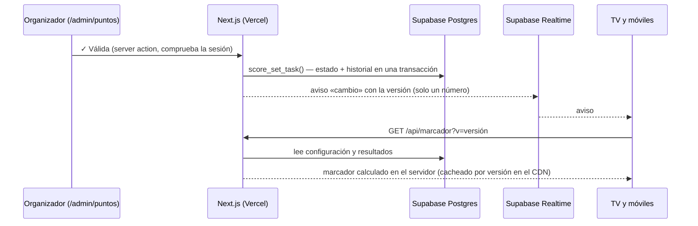

# 🏆 Marcador en tiempo real

Sistema de puntuación de la gincana:

- El organizador valida las pruebas desde el móvil.
- La tele de casa y los móviles de los jugadores ven la clasificación cambiar al momento, sin recargar.

| URL | Quién | Para qué |
|---|---|---|
| `/admin/puntos` | Organizador (login de admin) | Validar pruebas por equipo, bonus, extras, deshacer |
| `/admin/puntos/historial` | Organizador | Quién cambió qué y cuándo; deshacer |
| `/admin/puntos/config` | Organizador | Nombres de equipos, pruebas, puntos, bonus; reiniciar |
| `/tv` | Público (sin login) | Pantalla grande: clasificación animada y actividad reciente |
| `/marcador` | Público (sin login) | Lo mismo adaptado al móvil, con «mi equipo» resaltado |
| `/api/marcador` | Público (solo lectura) | Los datos públicos del marcador en JSON |

## 1. Cómo funciona



- **El total nunca se guarda.** Se calcula en el servidor en cada lectura con `computeScores()` (`src/lib/scoring.ts`), así que cambiar los puntos de una prueba recalcula todo al instante.
- **Fórmula:** total = pruebas válidas + bonus conseguidos + extras.
- **Empates:** comparten puesto (1, 1, 3…).
- **Escribir:** solo pasa por *server actions* que comprueban la sesión de admin (`requireAdmin()`) y por funciones de Postgres que solo puede ejecutar la clave secreta.
- **Leer en público:** `/api/marcador` solo devuelve nombres, puntos por actividad y el feed. Nunca devuelve notas, motivos de extras, historial ni configuración.
- **QR:** al escanear el QR de una localización del mapa, esa prueba queda **«pendiente de validar»** en el panel del equipo, solo si el QR está en su ruta. No puntúa hasta que la validas.

## 2. Tiempo real: qué se eligió y por qué

**Supabase Realtime (Broadcast) como aviso + API cacheada + sondeo de respaldo.**

- **Por qué no SSE o websockets propios:** en Vercel las funciones tienen un tiempo máximo, así que las conexiones largas se cortan y cuestan tiempo de ejecución por cada móvil conectado.
- **Por qué no Realtime suscrito a la tabla:** obligaría a dar a la clave pública permiso de lectura sobre las tablas, y con ello sobre las notas y el historial.
- **Por qué solo se emite la versión:**
  - el canal es público, así que un aviso falso solo haría que las pantallas pidan otra vez los datos auténticos;
  - con `?v=<versión>`, 30 móviles comparten **una sola respuesta del CDN** por cambio (`s-maxage=30`).
- **Si se cae la conexión:**
  - Supabase reconecta solo;
  - la pantalla muestra «Reconectando…» o «Sin conexión · reintentando»;
  - mientras tanto, cada 5 s pregunta a `/api/marcador` (cacheado 2 s);
  - con el canal en directo, el repaso de seguridad es cada 20 s;
  - al volver a la pestaña o recuperar la red, actualiza al momento.
- **Sin las variables `NEXT_PUBLIC_SUPABASE_*`** el marcador funciona igual, con «Actualización automática» cada 5 s.

## 3. Modelo de datos

| Tabla | Contenido |
|---|---|
| `score_activities` | Las 5 actividades, con nombre corto para la TV |
| `score_tasks` | Pruebas: puntos, grupo (Fáciles/Difíciles/Especial), si cuentan para bonus, QR asociado |
| `score_bonuses` | Bonus: `all` (todas), `min` (al menos N), `manual` (un solo equipo) |
| `task_results` | Estado por equipo y prueba: `pending` / `valid` / `invalid` + nota privada |
| `bonus_awards` | Qué equipo tiene «la prueba más creativa» (uno como máximo) |
| `score_extras` | Puntos extra por creatividad (+/−) con motivo privado |
| `score_log` | Historial (quién, qué, cuándo, estado anterior). Su último id es la **versión** del marcador |

- **Funciones (transacciones):** `score_set_task`, `score_set_award`, `score_add_extra`, `score_undo`, `score_undo_last`, `score_mark_qr`, `score_reset` y `score_log_config`.
- **Permisos:** solo las ejecuta `service_role`. A `anon`/`authenticated` se les retiran los permisos y las tablas tienen RLS sin políticas.
- **Partidas:** «Nueva partida» guarda el marcador en la copia y lo pone a 0. «Restaurar» lo recupera.

**Datos iniciales** (en `schema.sql`, editables en `/admin/puntos/config`):

| Actividad | Pruebas | Bonus |
|---|---|---|
| Un amigo es un tesoro | 8 × 3 pts | +10 con las 8 |
| La casa maldita | 6 × 2 pts | +5 a la más creativa (un equipo) |
| Los objetos perdidos | 5 fáciles × 1, 2 difíciles × 3, especial 5 | — |
| El mapa del muerto | Vito y Sara, Vito con gorra azul, La Harley + 2 QR de su ruta, 2 pts cada una | +10 con las 5 |
| El ritual | 8 × 4 pts + grito de guerra (0 pts, no cuenta para bonus) | +5 con ≥5, +15 con las 8 (acumulables) |

**Rutas QR:**

| Equipo | QR |
|---|---|
| Calabaza | Parkour, Rocódromo |
| Fantasma | Zigzag, Anfiteatro |
| Bruja | Zigzag, Parkour |
| Zombi | Rocódromo, Anfiteatro |

Las rutas se cambian en `/admin/qr`. Cada equipo solo ve y puntúa las localizaciones de su ruta.

## 4. Despliegue

1. **Base de datos:** Supabase → *SQL Editor* → pega `supabase/schema.sql` completo → *Run*.
   - Es re-ejecutable: crea las tablas del marcador, carga los datos iniciales sin pisar lo editado y migra lo anterior.
   - Los equipos ahora tienen una clave fija, así que se pueden renombrar sin romper emblemas ni rutas.
2. **Variables en Vercel** (*Settings → Environment Variables*):

   ```bash
   # Ya existentes
   SUPABASE_URL=https://tu-proyecto.supabase.co
   SUPABASE_SERVICE_ROLE_KEY=sb_secret_xxxx            # clave SECRETA
   ADMIN_PASSWORD=...
   ADMIN_SESSION_SECRET=...
   # Nuevas, para el tiempo real (clave PUBLICABLE: es pública por diseño)
   NEXT_PUBLIC_SUPABASE_URL=https://tu-proyecto.supabase.co
   NEXT_PUBLIC_SUPABASE_ANON_KEY=sb_publishable_xxxx
   ```

3. **Despliega de nuevo.** Las variables `NEXT_PUBLIC_*` se incrustan al compilar, así que hace falta un despliegue nuevo.
4. **Inicia sesión otra vez en el panel.** El formato de la sesión cambió para guardar tu nombre; las sesiones antiguas redirigen al login.
5. **Comprueba Realtime.** En el proyecto de Supabase, *Realtime* debe estar activo (lo está por defecto). Si en *Realtime → Settings* tienes activado «solo canales privados», desactívalo: el canal `marcador` es público.

## 5. Probarlo con 2 pestañas

1. **Pestaña A (marcador):** abre `/tv` (o `/marcador` en el móvil). Arriba a la derecha debe poner **● En directo**. Si pone «Actualización automática», faltan las variables `NEXT_PUBLIC_SUPABASE_*`.
2. **Pestaña B (panel):** `/admin/login` → tu nombre y la contraseña → **Puntuar** (`/admin/puntos`).
3. En B, elige **Bruja** y pulsa **✓ Válida** en «Figura de acrosport…». En A, en uno o dos segundos y sin recargar, Bruja sube con 3 puntos, su fila se anima y aparece «Bruja completó…» en «Lo último».
4. Valida las 8 de «Un amigo es un tesoro». En B verás «✓ Bonus tesoro: las 8 pruebas +10 · 8/8», y en A, Bruja con 34.
5. Pulsa **Deshacer** en el aviso de B. En A, el total vuelve atrás.
6. **Sin conexión:** desconecta la red de la pestaña A (DevTools → Network → Offline). Verás «Sin conexión · reintentando». Puntúa algo en B y vuelve a conectar A: se pone al día sola.
7. **Recálculo:** en `/admin/puntos/config`, cambia los puntos de una prueba. Todos los totales se recalculan en A.
8. **Historial:** en `/admin/puntos/historial` sale tu nombre en cada cambio. Prueba «Deshacer la última acción».
9. **Antes de la noche:** `/admin/partidas` → «Guardar copia y empezar partida nueva» (marcador a 0 y copia restaurable), o `/admin/puntos/config` → «Reiniciar marcador» escribiendo REINICIAR.

**En la tele:**
- Abre `/tv` y pulsa «Pantalla completa».
- Si el navegador soporta la Wake Lock API, la pantalla no se apaga. Si no la soporta, se avisa arriba: desactiva el apagado automático en los ajustes de la tele u ordenador.

## 6. Decisiones

| Decisión | Motivo |
|---|---|
| Sin dependencias nuevas | El tiempo real usa `@supabase/supabase-js` (ya instalado); los tests, `node --test` de Node 22 |
| Cálculo en TypeScript puro en el servidor | Una sola fuente de verdad, fácil de testear; nada se calcula en el cliente |
| Funciones de Postgres para escribir | Estado e historial en la misma transacción: el deshacer siempre es coherente |
| Versión = último id del historial | No hace falta contador aparte; sirve para el aviso y la caché |
| «Deshacer» comprueba cambios posteriores | Deshacer una acción antigua no pisa un cambio más reciente sobre la misma prueba |
| No se puede deshacer más allá de un reinicio | Evita resucitar puntos de otra partida |
| Nombre opcional en el login | Hay una sola contraseña de admin; el nombre identifica quién puntúa en el historial |
| Clave fija por equipo (`teams.slug`) | Renombrar «Zombie» → «Zombi» no rompe emblema, ruta ni mapa |
| Fotos y vídeos fuera | Las evidencias llegan por WhatsApp; subirlas exigiría Supabase Storage. Hay campo de nota privada |
| Alfa Slab One + Roboto Condensed | Coherente con el resto de la web (Oswald no aporta y sería otra fuente que cargar) |

## 7. Tests

```bash
npm test
```

Ejecuta los **14 tests** de `src/lib/scoring.test.ts`:
- puntos por actividad y bonus «todas», «al menos 5» (ritual) y manual de un solo equipo;
- localizaciones de QR solo para su ruta;
- pruebas pendientes y no válidas que no puntúan, y pruebas o bonus desactivados;
- extras positivos y negativos;
- empates (1, 1, 3, 4) y recálculo al cambiar puntos.
